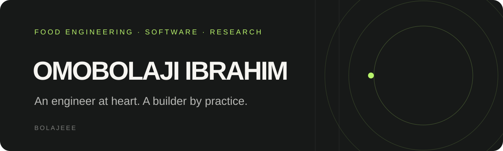

<div align="center">



<br />

<a href="https://leaderscvchecker.com"></a>


</div>

### `> whoami`

I'm **Omobolaji Ibrahim**, a software engineer building useful digital products and intelligent systems. My background in **Food Engineering** shapes how I approach software: understand the process, find the bottleneck, and design a solution that works in the real world.

I work across full-stack development, backend systems, automation, and data-driven products — with a growing interest in the intersection of **AI, engineering, and industry**.

```text
$ ./mission.sh
> Build thoughtfully.
> Solve practical problems.
> Keep learning, keep shipping.
```


### `> selected_work`

<table>
<tr>
<td width="50%" valign="top">

### 01 / Leaders AI Resume Analyser

An AI-powered recruitment platform that helps hiring teams analyse resumes, evaluate candidates against role-specific requirements, and make more informed screening decisions.

Designed to make recruitment faster, more structured, and human-centred.

**`AI` `Recruitment Tech` `Full-Stack`**

[](https://leaderscvchecker.com)

</td>
<td width="50%" valign="top">

### 02 / Civic AI

An AI-focused project exploring how intelligent technologies can be applied to civic challenges and public-interest solutions.

Built around the idea of making technology more useful, accessible, and impactful.

**`Artificial Intelligence` `Civic Tech` `Open Source`**

[](https://github.com/bolajeee/Civic-ai)

</td>
</tr>
</table>

<table>
<tr>
<td valign="top">

### 03 / AMMC Builders Liability Insurance

An engineering-driven digital platform designed to support builders' liability insurance operations, eligibility assessment, process automation, and structured record management.

Focused on improving operational efficiency, transparency, and data-driven decision-making within the insurance workflow.

**`InsurTech` `Process Automation` `Data Management` `Full-Stack`**

[](https://ammcbuildersinsurance.com)

</td>
</tr>
</table>

### `> engineering_interests`

```yaml
engineering:

  - full-stack product development
  - backend systems and APIs
  - AI-assisted workflows
  - data platforms and automation
  - reliable, maintainable software
beyond_code:

  - food and process engineering
  - technology for real-world industries
  - visual design and product thinking
```

### `> toolkit`

<div align="center">


<sub>Tools and technologies I work with or explore — always expanding the toolkit.</sub>

</div>

### `> activity_log`

<div align="center">

<!-- Replace bolajeee in the URLs below after sharing your GitHub handle. -->


</div>

> [!NOTE]
> GitHub statistics are provided by a third-party service and may occasionally be unavailable. Language charts reflect repository data, not overall proficiency.

### `> connect`

I'm interested in collaborating on products that make complex work simpler, faster, and more accessible.

**GitHub:** `@bolajeee`  
**Portfolio:** `https://bolajeee.vercel.app`  
**LinkedIn:** `https://linkedin.com/in/bolajeee`

<div align="center">


<sub>Designed with intention. Built with curiosity.</sub>

</div>
